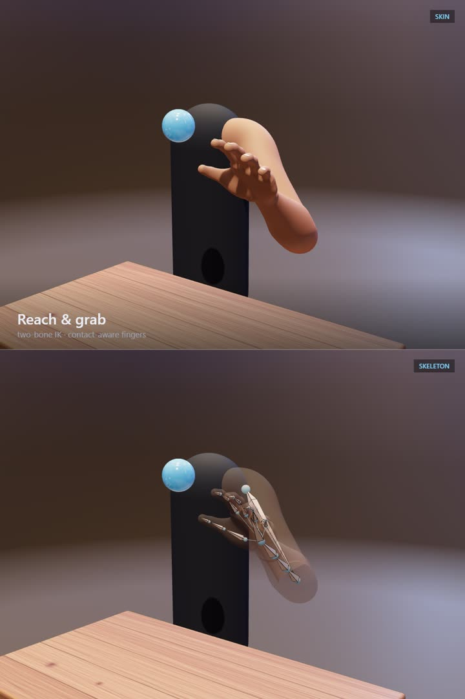

# Procedural rigged arm

A human arm and hand built entirely in code with three.js: the mesh, the skeleton, the skin weights and the motion. There are no model files and no animation clips. Everything lives in one HTML file.



## Run it

Live demo: https://procedural-arm-rig.vercel.app

Or open `index.html` in a browser. It loads three.js and the lighting environment from a CDN, so it needs a connection. It takes a few seconds to start, because the hand's skin is generated at load.

- **Motions** (bottom buttons, or keys 1–7): Reach & grab, Pick & place, Finger wave, Wave, Clench, Finger roll, Rest.
- **Views** (top right): Skin, X-ray (bones inside translucent skin), Weights.
- Drag to orbit, scroll to zoom, Space to pause. In Reach & grab you can drag the ball.

## What is in it

**Skeleton.** 38 bones: shoulder, upper arm, forearm, hand, and three per finger and thumb. The forearm twist is spread over three bones. The elbow and every finger joint have a helper bone that turns half the bend, so joints keep their volume instead of pinching.

**Skin.** The arm is a tube with painted weights. On the inside of the elbow the two segments stay nearly rigid and fold along a crease; on the outside the blend is wide. The hand is one seamless surface: palm, fingers and thumb are described as distance fields, blended where they meet, and meshed. The biceps and forearm swell as the elbow bends and the hand tenses.

**Arm motion.** The shoulder and elbow are solved analytically from where the hand needs to be. The forearm rolls to face the palm the right way, within anatomical limits. Every channel runs through a damped spring, and the wrist and fingers trail behind the hand's movement.

**Hand contact.** Each finger bone is a capsule tested against the palm, the other fingers, the ball and the table. A finger keeps last frame's pose and moves a limited amount per frame; each joint closes, knuckle first, until it touches. Blocked joints wait while the rest keep closing, which is what wraps a grip around an object. Joints have human ranges, and if a finger runs out of range against the table the whole hand rises.

**Hand behaviour.** Poses and the order of movement were tuned against slow-motion reference footage of a real hand:

- Closing a fist is two stages: the knuckles fold and the fingertips gather, then the fingers roll shut.
- The thumb closes a beat behind the fingers and lands as the index finger finishes.
- Fingers share tendons, so moving one drags its neighbours part of the way.
- A relaxed hand curls more toward the little finger.

## Recording the showcase video

The page can render a scripted two-panel video frame by frame, so it never drops frames.

```bash
node record-server.js
```

Open `http://localhost:5187/`, then run this in the browser console:

```js
await rig.direct()
```

Frames are written to `frames/`. Encode them with ffmpeg:

```bash
ffmpeg -framerate 60 -i frames/f_%05d.jpg -c:v libx264 -crf 18 -pix_fmt yuv420p showcase.mp4
```

The shot list, camera moves and ball path are in the `direct()` function in `index.html`.

## Known limits

- Only the fingers collide. The forearm and palm can pass through the table or the torso.
- Neighbouring fingers do not collide with each other.
- There is a faint seam at the wrist where the arm skin meets the hand skin.
- The wood and the skin are generated in code and are stylised, not photographic.
